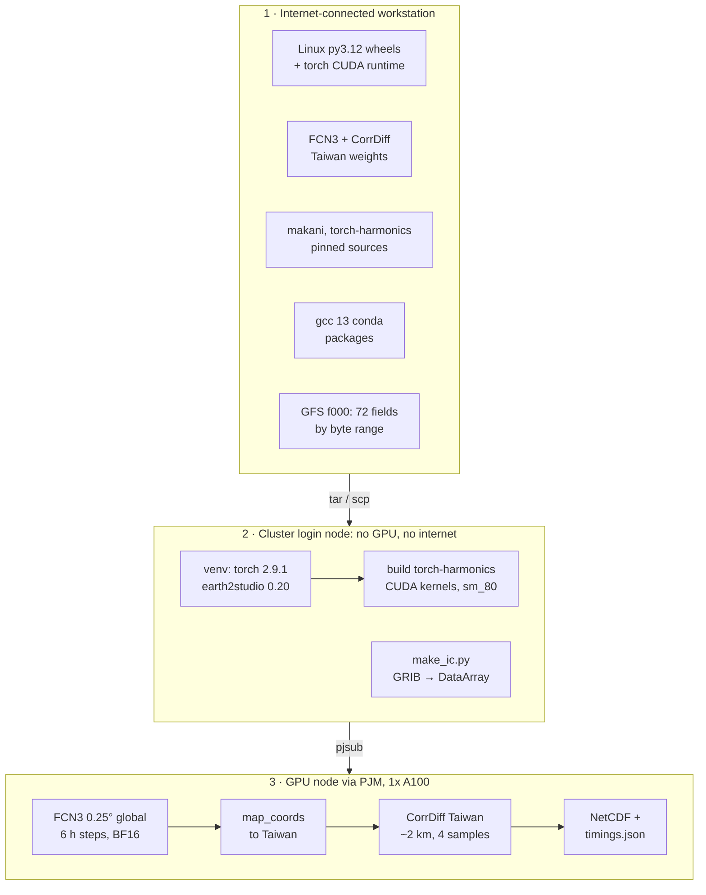
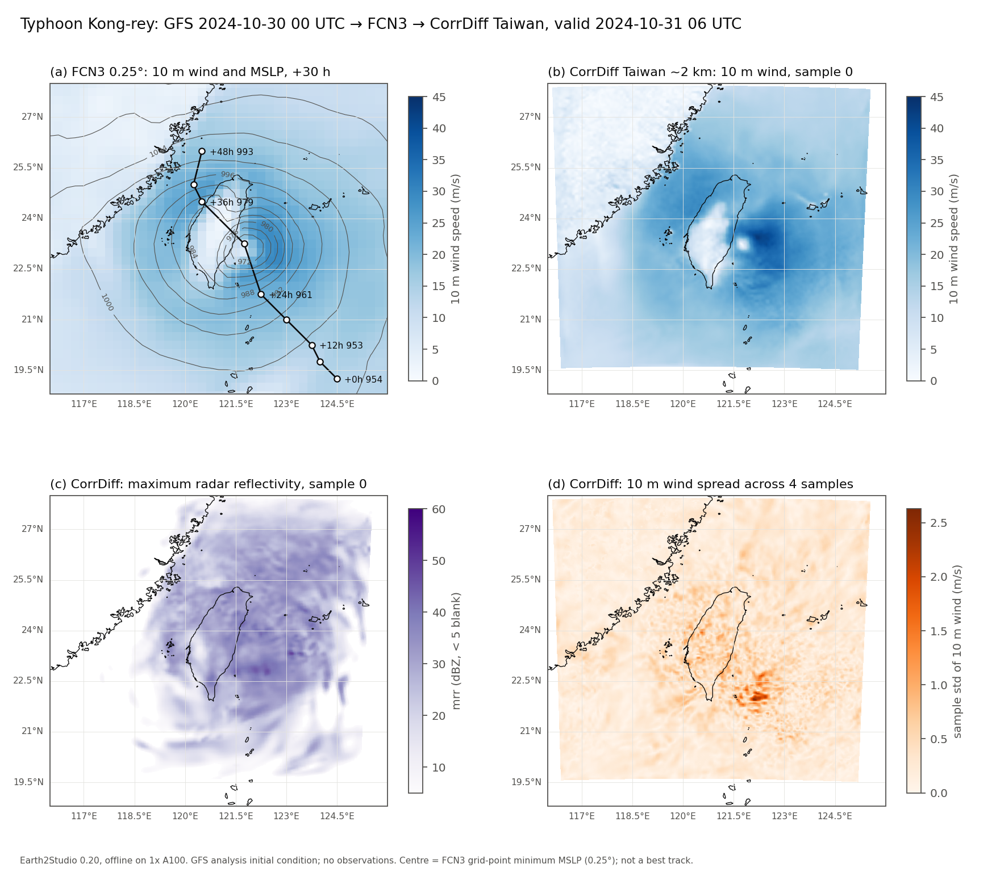
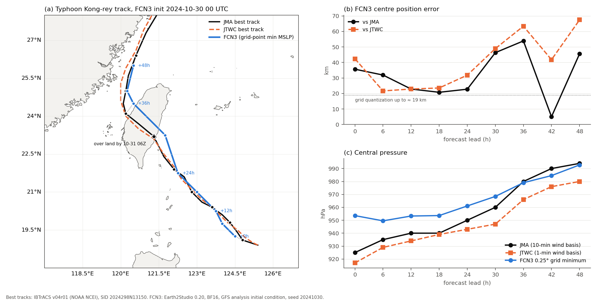
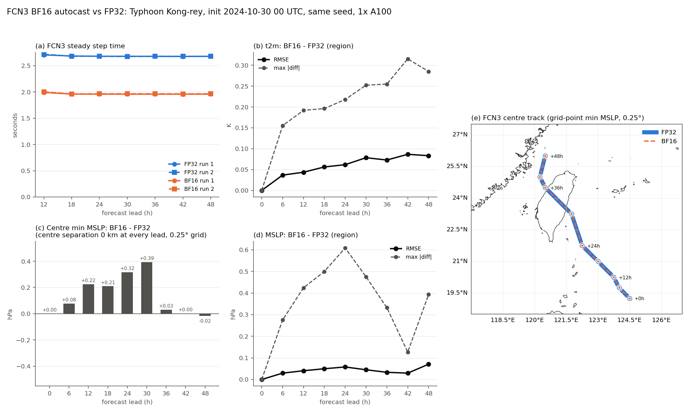
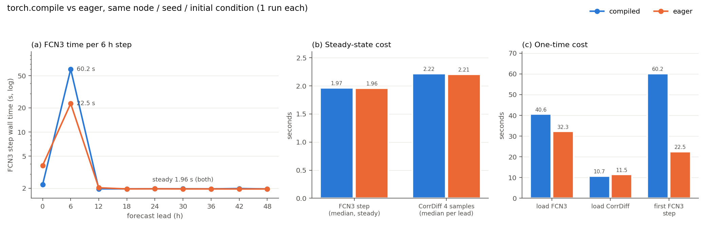
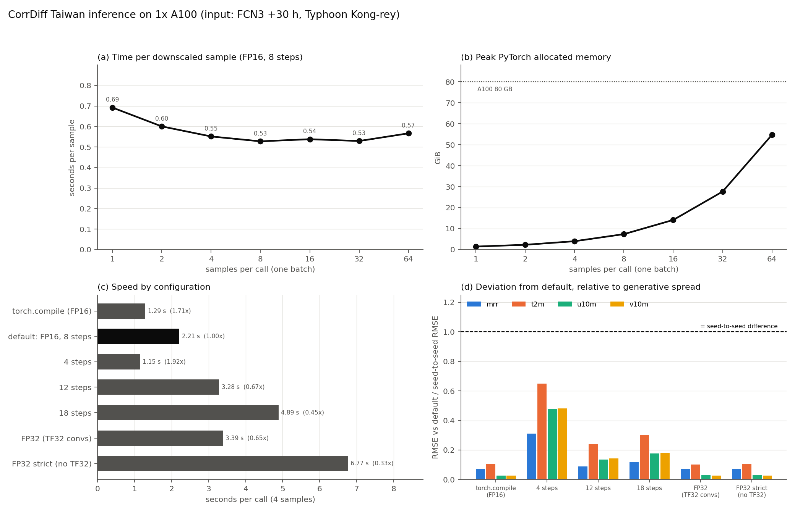
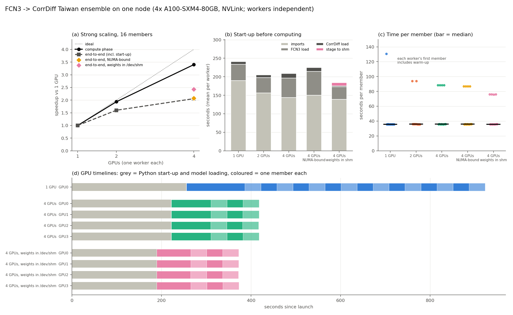

# Earth2Studio Taiwan: FCN3 → CorrDiff on an air-gapped A100 cluster

A reproducible, fully offline [Earth2Studio](https://github.com/NVIDIA/earth2studio) workflow that runs the
**FourCastNet v3 (FCN3)** global forecast model and downscales it over Taiwan with **CorrDiff Taiwan**
(~2 km, generative diffusion). It was built and benchmarked on a GPU cluster with **no internet access**,
an old system compiler and an older NVIDIA driver, which are typical for government and academic HPC sites.

The case is **Typhoon Kong-rey (2024)**: GFS analysis at 2024-10-30 00 UTC, a 48-hour forecast in 6-hour steps,
and four CorrDiff samples per lead time.

**Results at a glance (1x A100-SXM4-80GB):**

| | |
|---|---|
| FCN3, one 6-hour step (BF16 autocast, Earth2Studio default) | **1.96 s** |
| FCN3, one 6-hour step (FP32) | 2.68 s, so BF16 is **1.37x** faster |
| CorrDiff Taiwan, 4 samples per lead time | 2.21 s (0.55 s per sample); **1.29 s with `torch.compile` (1.71x)** |
| 48-hour forecast + downscaling (8 steps at steady-state speed) | ~33 s |
| 16-member ensemble, 1 → 4 GPUs on one node | 3.40x in the compute phase, but **2.06x end-to-end**: ~3.5 min of Python start-up and model loading per process |
| Peak PyTorch allocated memory | 49.4 GiB |
| BF16 vs FP32, regional t2m / MSLP RMSE at +48 h | 0.083 K / 0.071 hPa; same typhoon-centre grid point at every lead |
| `torch.compile` on FCN3 | no steady-state gain (1.97 vs 1.96 s); +38 s compile on the first step |
| FCN3 centre track vs JMA best track, +6..+48 h | mean 31 km (40 km vs JTWC); initial central pressure 29 hPa too weak, inherited from the GFS analysis |

This is a performance and engineering study of **one** case, not a forecast-skill evaluation. The FCN3 track is
checked against IBTrACS best tracks as a sanity check; one case cannot characterize FCN3's skill.

## Architecture



The run script mirrors `earth2studio.run.diagnostic`: fetch → `map_coords` → prognostic iterator → `map_coords`
→ diagnostic. Each stage is timed separately with CUDA synchronization, and the FCN3 Taiwan-region fields and
every CorrDiff sample are saved for inspection.

## Repository layout

| Path | Purpose |
|---|---|
| `offline/download_offline.sh` | Everything to fetch on the internet-connected machine |
| `offline/requirements-e2s.txt` | Linux wheel set (Earth2Studio base + `corrdiff` + `fcn3` extras, makani deps) |
| `offline/gcc13_explicit.txt` | conda explicit file for the gcc 13 toolchain (offline install) |
| `offline/fetch_gfs_ic.py` | Byte-range download of the 72 FCN3 input fields from one GFS analysis |
| `site.env.example` | Site-specific paths (toolchain, CUDA toolkit, Python); copy to `site.env` |
| `jobs/build_th.sh` | Builds torch-harmonics CUDA kernels with gcc 13 + nvcc 12.6, installs makani |
| `jobs/common.sh` | Runtime environment shared by the PJM jobs |
| `scripts/make_ic.py` | GRIB subset → Earth2Studio `DataArrayFile`, with the GFS lexicon unit conversions |
| `scripts/run_fcn3_corrdiff.py` | FCN3 → CorrDiff Taiwan with per-stage timings; `--fcn3-precision bf16\|fp32` |
| `jobs/e2s_job_large.sh` | PJM job: one forecast |
| `jobs/e2s_compile_job.sh` | PJM job: `torch.compile` vs eager on the same node and seed |
| `jobs/e2s_precision_job.sh` | PJM job: BF16 vs FP32, ABBA order, 2 runs each |
| `scripts/compare_runs.py`, `scripts/compare_precision.py`, `scripts/plot_run.py` | Comparison tables and figures |
| `scripts/track_verify.py` | FCN3 centre track and central pressure vs IBTrACS JMA / JTWC best tracks |
| `scripts/corrdiff_bench.py`, `scripts/plot_corrdiff_bench.py` | CorrDiff precision / steps / batching / `torch.compile` benchmark with NVTX ranges |
| `jobs/corrdiff_bench_job.sh` | PJM job: CorrDiff benchmark, then an Nsight Systems capture of the default configuration |
| `scripts/ensemble_worker.py`, `scripts/plot_ensemble_scaling.py` | One ensemble worker per GPU with timestamps and output hashes; scaling summary and timeline |
| `jobs/ensemble_scaling_job.sh` | PJM job: 16 members on 1, 2 and 4 GPUs, plus NUMA-bound and `/dev/shm` variants |
| `results/`, `figures/` | Measured outputs used in this README |

Model weights, wheels and forecast outputs are not committed. All site-specific paths live in `site.env`;
the only other edits for a new cluster are the `#PJM -L rscunit=` / `rscgrp=` lines in `jobs/*.sh`
(or the equivalent directives for another scheduler).

## Tested environment

| Item | Value |
|---|---|
| GPU node | 4x A100-SXM4-80GB (1 used), driver 535.154.05 (CUDA 12.2) |
| OS / scheduler | RHEL 8.6, glibc 2.28, Fujitsu PJM |
| System compiler | gcc 8.5 (login node); GPU nodes have no `cc1` |
| CUDA toolkit for builds | NVHPC 24.11, CUDA 12.6 |
| Python | 3.12.8 (site miniforge) in a dedicated venv |
| Key packages | torch 2.9.1+cu126, earth2studio 0.20.0, nvidia-physicsnemo 2.0.0, warp-lang 1.12.0, makani b38fcb2, torch-harmonics a632ca7 (0.8.1) |

## Offline deployment

### 1. On the internet-connected workstation

```bash
OUT=$TEMP/e2s bash offline/download_offline.sh
```

This produces about 7.5 GB: 182 wheels (3.9 GB), FCN3 weights (2.8 GB), the CorrDiff Taiwan package (717 MB),
two source archives, 18 gcc 13 conda packages (133 MiB) and the GFS subset (57 MiB). Copy this repository and the
downloads to the cluster; `$ROOT` below is the repository's location there (the deployment root).

```bash
tar -cf - -C "$TEMP/e2s" wheels src models gfs | ssh cluster "tar -xf - -C $ROOT"
tar -cf - -C "$TEMP/e2s" gcc13_pkgs | ssh cluster "tar -xf - -C /path/to/toolchains"
```

### 2. On the cluster login node

```bash
cd $ROOT
cp site.env.example site.env       # set TOOLCHAIN, CUDA_TOOLKIT, CUDA_MATH_INCLUDE, BASE_PYTHON
source ./site.env

# Python environment (separate from any operational environment)
$BASE_PYTHON -m venv venv
venv/bin/python -m pip install --no-index --find-links wheels -r offline/requirements-e2s.txt
venv/bin/python -m pip install --no-index --no-deps wheels/earth2studio-0.20.0-py3-none-any.whl

# gcc 13 toolchain, installed offline from local packages (no solver, no network)
sed "s#@PKG_DIR@#/path/to/toolchains/gcc13_pkgs#" offline/gcc13_explicit.txt > gcc13_explicit.local.txt
CONDA_PKGS_DIRS=/path/to/toolchains/pkgs_cache conda create -p "$TOOLCHAIN" \
    --offline --yes --file gcc13_explicit.local.txt

# torch-harmonics CUDA kernels (sm_80) and makani from the pinned sources
bash jobs/build_th.sh     # prints "disco optimized kernels: True attention: True" on success

# Initial condition
mkdir -p data
venv/bin/python scripts/make_ic.py --grib gfs/gfs_20241030T00_f000_fcn3.grib2 \
    --manifest gfs/manifest.json --output data/gfs_20241030T00_ic.nc
```

`make_ic.py` checks each message's GRIB name and level against the Earth2Studio GFS lexicon and the manifest,
applies the lexicon's unit modifiers (e.g. geopotential height x 9.81), and validates the 0.25-degree grid.
For this case the analysis minimum MSLP is 951.3 hPa.

### 3. On a GPU node

Set the resource unit and queue in the `#PJM` lines first, then submit from `$ROOT`:

```bash
pjsub jobs/e2s_job_large.sh        # one forecast
pjsub jobs/e2s_precision_job.sh    # BF16 vs FP32 benchmark (figure needs PLOT_PYTHON in site.env)
```

`jobs/common.sh` sets the runtime environment that every job needs:

```bash
export LD_LIBRARY_PATH=$TOOLCHAIN/lib:$LD_LIBRARY_PATH          # libstdc++ for the gcc-13-built kernels
export CC=$TOOLCHAIN/bin/x86_64-conda-linux-gnu-gcc \
       CXX=$TOOLCHAIN/bin/x86_64-conda-linux-gnu-g++            # Triton/Inductor JIT on GPU nodes without cc1
export HF_HUB_OFFLINE=1 EARTH2STUDIO_CACHE=$ROOT/cache
```

Models load from local directories with `Package("/path/to/models/fcn3")`, and the initial condition comes from
`earth2studio.data.DataArrayFile`, so nothing tries to reach the network.

## Pitfalls and fixes

Each of these stopped the workflow at least once. The symptom is what you see; the cause is what was actually wrong.

| # | Symptom | Cause | Fix |
|---|---|---|---|
| 1 | `pip download` succeeds but torch fails on the cluster with missing `libcudnn`/`libcublas` | `pip download --platform linux` evaluates `platform_system == "Linux"` markers against the **local** OS (Windows), silently dropping torch's 15 `nvidia-*-cu12` wheels and `triton` | Read them from the torch wheel's METADATA and download them explicitly (`download_offline.sh` step 1) |
| 2 | `ResolutionImpossible` around `hydra-core` | `antlr4-python3-runtime==4.9.*` is sdist-only, so `--only-binary=:all:` cannot satisfy it | Build a pure-Python wheel locally with `pip wheel` and add `--find-links` |
| 3 | `nvidia-physicsnemo` conflicts with torch | physicsnemo ≥ 2.1 requires torch ≥ 2.10, but the cu126 index stops at torch 2.9.1 (the driver cannot run cu13) | Use physicsnemo 2.0.0 (torch ≥ 2.4), which satisfies Earth2Studio's `corrdiff` extra |
| 4 | Windows: `Filename too long` during clone or `pip download` | MAX_PATH limit with deep scratch directories | Download under a short path (`%TEMP%\e2s`); move repos with `git bundle` instead of checkout |
| 5 | torch-harmonics will not build: `We need GCC 9 or later` | The system gcc is 8.5; torch 2.9 headers require ≥ 9. Even the CPU helper modules include `torch/extension.h` | Install conda-forge gcc 13 + sysroot 2.28 **offline** from a conda explicit file; build with `CC`/`CXX` set to it |
| 6 | `fatal error: cusparse.h: No such file or directory` | NVHPC ships cuSPARSE/cuBLAS headers in `math_libs/<cuda>/include`, not under `CUDA_HOME` | Add that directory to `CPATH` and `NVCC_PREPEND_FLAGS=-I...` (`jobs/build_th.sh`) |
| 7 | `AttributeError: module 'warp' has no attribute 'context'` when importing CorrDiff | physicsnemo 2.0.0 uses `wp.context.Device`, removed in warp 1.18; warp 1.18 is also a CUDA 13.4 build that cannot use a 12.2 driver | Pin `warp-lang==1.12.0`, released alongside physicsnemo 2.0.0 |
| 8 | `torch._inductor ... CalledProcessError: /bin/gcc ... cuda_utils.c` on the GPU node | **GPU nodes have no `cc1`** (`gcc: error trying to exec 'cc1'`), so Triton's JIT cannot compile. The first guess, a missing `libcuda.so`, was wrong: it exists | Set `CC`/`CXX` to the conda gcc 13 in the job. Read the compiler's own stderr before guessing |
| 9 | `ImportError: libc10.so` from a one-line kernel check | Importing `disco_helpers` before `torch` has loaded `libc10` | `import torch` first |
| 10 | "BF16 vs FP32" initially looked like a no-op | Earth2Studio's FCN3 **already** runs under BF16 autocast whenever the torch-harmonics CUDA extension is present (`_cuda_extension_available`) | FP32 control: set `earth2studio.models.px.fcn3._cuda_extension_available = False` after loading; it only selects the autocast dtype, and the kernels stay the same |
| 11 | Risk of corrupt CorrDiff weights when several workers start together | `CorrDiffTaiwan.load_model` re-extracts its package zip into the same directory on **every** load, so concurrent workers overwrite files that others are reading | Skip extraction when every file is already present at the right size (`scripts/ensemble_worker.py`), or give each worker its own copy |
| 12 | FP32 "control" for CorrDiff silently used rounded weights | The loader sets `use_fp16=True`, whose setter casts the weights themselves; setting it back to `False` keeps FP16-rounded values | Reload both networks from the checkpoint for FP32 runs (`scripts/corrdiff_bench.py`) |

## Results

All timings are wall-clock with CUDA synchronization around each stage, on one A100. Step 0 returns the initial
condition; step +6 h includes warm-up. "Steady" means the median over +12..+48 h.

### Typhoon Kong-rey, valid 2024-10-31 06 UTC (+30 h)



- (a) FCN3 10 m wind with MSLP contours and the FCN3 centre track (grid-point MSLP minimum, every 6 h).
- (b) CorrDiff resolves the eye, the strong-wind band east of the island and the lee-side weak-wind area west of
  the Central Mountain Range, none of which the 0.25-degree field can represent. CorrDiff's maximum 10 m wind is
  42–49 m/s before landfall, against 30–36 m/s in FCN3.
- (c) Maximum radar reflectivity (CorrDiff diagnostic), 43–55 dBZ maxima over the 48 hours.
- (d) The spread across the 4 samples (up to ~2.5 m/s) concentrates in the eyewall region.

### Track check against best tracks (IBTrACS: JMA and JTWC)



| Lead | Valid (UTC) | FCN3 centre | JMA | JTWC | Error vs JMA | Error vs JTWC |
|---:|---|---|---|---|---:|---:|
| +0 h | 10-30 00 | 953.6 hPa, 19.25N 124.50E | 925 hPa, 19.1N 124.8E | 917 hPa, 19.2N 124.9E | 36 km | 42 km |
| +12 h | 10-30 12 | 953.3 hPa, 20.25N 123.75E | 940 hPa, 20.4N 123.6E | 934 hPa, 20.4N 123.6E | 23 km | 23 km |
| +24 h | 10-31 00 | 961.1 hPa, 21.75N 122.25E | 950 hPa, 21.9N 122.1E | 943 hPa, 22.0N 122.1E | 23 km | 32 km |
| +30 h | 10-31 06 | 968.4 hPa, 23.25N 121.75E | 960 hPa, 23.2N 121.3E | 947 hPa, 23.1N 121.3E | 46 km | 49 km |
| +36 h | 10-31 12 | 979.1 hPa, 24.50N 120.50E | 980 hPa, 24.1N 120.2E | 966 hPa, 24.0N 120.2E | 54 km | 63 km |
| +48 h | 11-01 00 | 992.8 hPa, 26.00N 120.50E | 994 hPa, 26.4N 120.6E | 980 hPa, 26.6N 120.6E | 46 km | 67 km |

Every 6-hour lead: [`results/kongrey_track_verification.txt`](results/kongrey_track_verification.txt).

- **Track:** FCN3 stays within 21–32 km of the JMA track through +24 h, close to the 19 km worst-case
  quantization of a 0.25-degree grid-point minimum. The error grows to 46–54 km while the storm crosses Taiwan
  (+30 to +36 h): at 06 UTC on 10-31 the best track is already over land (23.2N 121.3E, the first 3-hourly
  point with zero distance to land), while the FCN3 centre is still about 45 km east of it, off the east coast.
- **Intensity:** the initial central pressure is 29 hPa too high against JMA (37 hPa against JTWC). That error
  comes from the GFS analysis at 0.25 degrees, not from the forecast. It shrinks as the real storm weakens, and
  after landfall FCN3 is within 6 hPa of JMA.
- JMA (the WMO regional centre, 10-minute wind basis) and JTWC (1-minute wind basis) differ by up to 14 hPa in
  central pressure for the same storm at these times, so the reference agency is named for every intensity number.

### BF16 autocast vs FP32 (FCN3 only; CorrDiff unchanged)

Same node, seed and initial condition; ABBA order (BF16, FP32, FP32, BF16). Runs of the same precision are
bit-identical, so every difference below comes from precision alone. "FP32" uses PyTorch defaults: matmul TF32
off, cuDNN TF32 on (both recorded in `timings.json`).



| | FP32 | BF16 |
|---|---:|---:|
| FCN3 steady step (2 runs) | 2.678 / 2.679 s | 1.957 / 1.964 s |
| Speedup | | **1.37x** |
| CorrDiff per lead (4 samples) | 2.21 s | 2.21 s |
| Peak allocated memory | 49.33 GiB | 49.37 GiB |

| Lead | t2m RMSE / max \|diff\| (K) | MSLP RMSE / max \|diff\| (hPa) | Centre (BF16 vs FP32) |
|---:|---|---|---|
| +6 h | 0.037 / 0.16 | 0.029 / 0.28 | same grid point, +0.08 hPa |
| +24 h | 0.062 / 0.22 | 0.058 / 0.61 | same grid point, +0.32 hPa |
| +30 h | 0.078 / 0.25 | 0.045 / 0.48 | same grid point, +0.39 hPa |
| +48 h | 0.083 / 0.29 | 0.071 / 0.39 | same grid point, −0.02 hPa |

Region 15–32N, 112–130E, cosine-latitude weighted RMSE. Downstream, CorrDiff's sample-mean t2m differs by at most
0.087 K RMSE and 10 m wind by 0.26 m/s. Full table: [`results/bf16_vs_fp32.txt`](results/bf16_vs_fp32.txt).

**Why memory does not drop:** makani disables autocast and casts to FP32 inside the spherical harmonic
transforms and spectral convolutions, and torch-harmonics' DISCO kernels cast their inputs to FP32, so BF16
only applies to the remaining layers.

**Why the end-to-end gain is smaller:** CorrDiff costs as much as FCN3 per lead time, so BF16 FCN3 shortens
one forecast + downscaling step from about 4.89 s to 4.17 s (15%). Profile the whole pipeline before choosing
what to optimize.

### torch.compile vs eager (models as shipped)



| | compiled | eager |
|---|---:|---:|
| FCN3 steady step | 1.97 s | 1.96 s |
| CorrDiff per lead | 2.22 s | 2.21 s |
| First FCN3 step (compile / warm-up) | 60.2 s | 22.5 s |
| Output difference | 0 (bit-identical) | |

In the pinned makani version, `@torch.compile` on the FCN3 network is commented out ("long initial compile
times"), several blocks are wrapped in `torch.compiler.disable`, and only small einsum contractions are
compiled. The expensive operators are torch-harmonics' own CUDA kernels. Fixing the JIT toolchain (pitfall 8)
still matters for other models, but it does not speed up FCN3. The FCN3 load-time difference (40.6 vs 32.3 s)
most likely reflects a warm file-system cache on the second run, not compilation. CorrDiff is unchanged here
because Earth2Studio also leaves its `torch.compile` calls commented out; compiling it explicitly is the
largest gain in the next section.

### CorrDiff: profile first, then optimize

CorrDiff costs as much per lead time as FCN3, so it is the next bottleneck. Every configuration below
downscales the same input (FCN3 at +30 h, Kong-rey near landfall) with the same seed, 5 timed calls each.
The default is Earth2Studio's: FP16 weights, 8 Euler steps, `channels_last`, all samples in one batch.



**What Nsight Systems shows (default configuration):** the diffusion network runs 8 times per call and accounts
for about 98% of the sampler's GPU time (~0.27 s per evaluation; the regression network runs once). By kernel
type, **68% of GPU time is element-wise, GroupNorm and SiLU kernels** and only 29% is tensor-core convolution:
the network is limited by memory traffic, not arithmetic. One call launches about 18,000 kernels, but the CPU
is ahead of the GPU (most CUDA API time is spent waiting in `cudaStreamSynchronize`), so the fix is fewer,
larger kernels rather than lower launch overhead.

| Configuration (4 samples) | Seconds per call | vs default | Peak GiB | Deviation from default / seed-to-seed spread |
|---|---:|---:|---:|---|
| `torch.compile` (FP16) | 1.29 | **1.71x** | 3.98 | 0.03–0.11 |
| Default: FP16, 8 steps | 2.21 | 1.00x | 4.00 | reference |
| 4 Euler steps | 1.15 | 1.92x | 4.00 | 0.31–0.65 |
| 12 Euler steps | 3.28 | 0.67x | 4.00 | 0.09–0.24 |
| 18 Euler steps | 4.89 | 0.45x | 4.00 | 0.12–0.30 |
| FP32, TF32 convolutions (PyTorch default) | 3.39 | 0.65x | 7.69 | 0.03–0.10 |
| FP32 strict (TF32 off) | 6.77 | 0.33x | 7.69 | 0.03–0.11 |

The last column is the per-sample RMSE against the default (same seed), divided by the RMSE between two seeds
of the default, i.e. the spread the generative model produces anyway; ranges cover mrr, t2m, u10m and v10m.
Full numbers: [`results/corrdiff_bench_summary.txt`](results/corrdiff_bench_summary.txt).

- **`torch.compile` is both faster and closer to FP32.** Kernel fusion removes most of the memory-bound
  element-wise traffic Nsight identified. Its outputs are about 7x closer to strict FP32 than eager FP16 is
  (RMSE to FP32: mrr 0.017 vs 0.121 dBZ, t2m 0.004 vs 0.027 K), most likely because the fused kernels compute
  in FP32 internally. The cost is a 113 s first call per fresh process (cold compile cache).
- **FP16 is worth keeping:** 1.54x faster than FP32 with TF32 and 3.07x faster than strict FP32, at half the
  memory, while differing from FP32 by 3–11% of the seed-to-seed spread. On A100, PyTorch's "FP32"
  convolutions already use TF32 by default.
- **Diffusion steps trade linearly** (about 0.27 s per Euler step plus a small fixed cost). Four steps halve
  the time and stay within the generative spread; whether they are still physically adequate needs verification
  against observations, which this benchmark does not do.
- **Batching:** time per sample falls from 0.69 s (1 sample) to about 0.53 s from 8 samples on, and memory grows
  by about 0.85 GiB per sample (54.7 GiB at 64), so roughly 90 samples fit in 80 GB.

**Sizing a 50-member, 45-day downscaling on one A100 (projection):** eager FP16 at 0.53 s per sample gives
about 27 s per lead time and **about 20 min per initialization**. With `torch.compile` (0.32 s per sample,
measured only at 4 samples) the projection is about 12 min, if the per-sample gain holds at larger batches.

### Ensemble on 4 GPUs: strong scaling and the start-up wall

Ensemble members are independent, so the simplest multi-GPU layout is one worker process per GPU with members
split round-robin. 16 members (FCN3 48 h + CorrDiff 4 samples per lead, eager, default precision), members
differing only by seed. The four A100s are NVLink-connected, but these workers never communicate.



| Configuration | End-to-end | Speedup / efficiency | Compute phase | Speedup / efficiency | Ready to compute |
|---|---:|---:|---:|---:|---:|
| 1 GPU | 980.5 s | 1.00x / 1.00 | 667.3 s | 1.00x / 1.00 | 255 s |
| 2 GPUs | 612.7 s | 1.60x / 0.80 | 344.8 s | 1.94x / 0.97 | 221 s |
| 4 GPUs | 476.8 s | 2.06x / 0.51 | 196.3 s | 3.40x / 0.85 | 222 s |
| 4 GPUs, NUMA-bound | 471.9 s | 2.08x / 0.52 | 194.8 s | 3.43x / 0.86 | 233 s |
| 4 GPUs, weights in `/dev/shm` | 403.5 s | 2.43x / 0.61 | 183.6 s | 3.63x / 0.91 | 189 s |

End-to-end runs from launching the workers to the last member; the compute phase starts when the first worker
starts its first member. Full numbers: [`results/ensemble_scaling_summary.txt`](results/ensemble_scaling_summary.txt).

- **The GPUs do not slow each other down.** The median member takes 35.8 s in every configuration
  (FCN3 15.6 s, CorrDiff 20.0 s), and all 16 members are **bitwise identical** to the 1-GPU run in every
  configuration (SHA-256 of every CorrDiff input and output).
- **The compute phase scales well (3.40x on 4 GPUs).** What it loses is each worker's first member, which is
  40–95 s slower (first-call warm-up of FCN3 and CorrDiff) and is paid once per worker instead of once per run.
- **End-to-end scaling stops at about 2x because of start-up.** Every worker spends 3 to 4.5 minutes before its first
  member: **Python imports take 140–190 s**, then FCN3 loads in 34–64 s. The virtual environment sits on the
  Lustre parallel file system (7.8 GB, about 78,000 files, 3.6 GB of CUDA libraries), and importing the FCN3 and
  CorrDiff classes also imports every model module in `earth2studio.models.px`. Concurrent workers stay in
  lock-step during start-up because they read the same files through the shared page cache, so they do not
  contend with each other; the cost is the same fixed wall for 1 or 4 workers.
- **Staging the weights in `/dev/shm`** (8.8 s copy) cuts FCN3 loading to 34 s and CorrDiff loading to 2 s and
  raises end-to-end speedup to 2.43x. **NUMA binding changes nothing** (2.08x vs 2.06x): this workload is
  GPU-bound, and only 16 of the node's 32 cores sit next to a GPU anyway.

**Sizing (projection from these measurements):** 50 members per initialization take about 35 min on one A100 and
about 12 min on four (13 members on the busiest GPU at 35.8 s each, plus one warm-up and start-up). For an
operational service, the start-up wall argues for packaging the environment as a single image on fast local
storage and for keeping models resident in a long-running inference service rather than starting Python per run.

## Limitations

- One typhoon case, 48 hours, one GPU; each timing configuration was measured once or twice.
- The CorrDiff benchmark uses a single input field; `torch.compile` was timed only at 4 samples, and its
  compile cost was measured with a cold cache.
- The ensemble scaling job ran each configuration once, in a fixed order on one node; start-up times depend on
  the shared file system's load at that moment and on page-cache state, which a user job cannot reset.
- The centre track is the FCN3 grid-point MSLP minimum (0.25°, ~28 km cells, up to ~19 km quantization);
  "same grid point" means both precisions fall in the same cell.
- The track check uses JMA and JTWC best tracks from IBTrACS, not CWA's own best track. One case cannot measure
  track or intensity skill.
- The initial condition is a GFS analysis. CorrDiff fields (wind, reflectivity) are not verified against
  station or radar observations.
- FCN3 is stochastic; a fixed seed (20241030) makes runs reproducible but represents one ensemble member.

## Licenses and data

- **This repository's code and documentation:** [Apache-2.0](LICENSE), Copyright 2026 yinruei (see [NOTICE](NOTICE)).
  Model weights, wheels and input data are not included; each keeps its own license, listed below.
- FCN3 weights: [nvidia/fourcastnet3](https://huggingface.co/nvidia/fourcastnet3) (Apache-2.0), commit `76ef0c6`.
- CorrDiff Taiwan: [NGC `nvidia/modulus/corrdiff_inference_package` v1](https://catalog.ngc.nvidia.com/orgs/nvidia/teams/modulus/models/corrdiff_inference_package); see the package's `LICENSE.txt`.
- GFS: NOAA Global Forecast System via the [NOAA Open Data Dissemination program on AWS](https://registry.opendata.aws/noaa-gfs-bdp-pds/).
- Best tracks: [IBTrACS v04r01](https://www.ncei.noaa.gov/products/international-best-track-archive) (NOAA NCEI;
  Knapp et al., 2010, *BAMS*), `ibtracs.last3years.list.v04r01.csv` downloaded 2026-11-02, storm SID `2024298N13150`.
- Earth2Studio, physicsnemo, makani, torch-harmonics: Apache-2.0 (NVIDIA).
